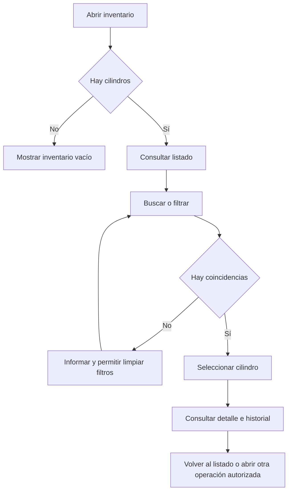

# PN-02 · Consulta de inventario en bodega

## Estado

Flujo descrito en la conversación a solicitud de Dante. **Pendiente de su revisión
y confirmación**; no se declara aprobado por el cliente ni implementado.

Actualización posterior: primera versión en memoria implementada en
[03_CODIGO](../03_CODIGO/README.md). Incluye listado, filtros de estado/gas,
búsqueda por código/serie, detalle, QR e historial de alta/pesaje. Las secciones
de OT, custodia, terreno y retorno siguen pendientes; no se consideran
implementadas por esta actualización. La aceptación del proceso sigue pendiente.

## Objetivo y actor

Permitir al usuario de bodega conocer qué cilindros existen, su refrigerante,
estado y disponibilidad, y consultar el detalle de los que fueron despachados.
Los accesos adicionales de otros roles deben definirse aparte.

## Condiciones previas

- El usuario está autenticado y autorizado para consultar inventario.
- Existen registros de refrigerantes y cilindros, o se muestra el estado vacío.
- Se distingue el último pesaje real de una estimación de contenido.

## Paso 1 · Abrir inventario

El usuario entra a **Inventario de cilindros**. Se muestra una fila por cilindro:

| Dato | Significado |
| --- | --- |
| Código/QR | Identificación del envase. |
| Refrigerante | Único tipo asignado al cilindro. |
| Capacidad | Cantidad máxima de gas. |
| Tara | Peso del envase vacío. |
| Último peso bruto registrado | Última lectura de balanza conservada. |
| Fecha del pesaje | Antigüedad de esa lectura. |
| Estado | Disponibilidad o situación operativa. |

Sin lecturas, se muestra **Sin pesaje registrado**, nunca cero por defecto.
Sin cilindros, se informa que no hay inventario registrado.

## Paso 2 · Buscar y filtrar

- Leer QR o ingresar código/número de serie.
- Filtrar por refrigerante.
- Filtrar por estado.
- Limpiar filtros para volver al listado completo autorizado.

Ejemplo de consulta: cilindros disponibles que contienen R-134a.
Si no hay coincidencias, informar y permitir cambiar los filtros.

## Paso 3 · Abrir el detalle

Al seleccionar un cilindro se muestra:

1. Identificación: código, serie, refrigerante, capacidad y tara.
2. Situación: estado, último peso bruto, fecha y contenido calculado.
3. Si está despachado: técnico custodio, OT y fecha de salida.
4. Historial de pesajes y movimientos.
5. Intervenciones asociadas cuando ese proceso esté disponible.
6. Evidencias autorizadas y resultados de retorno/conciliación cuando existan.

No presentar como implementados datos de procesos que aún no están programados.

## Paso 4 · Interpretar los pesos

```text
Contenido según último pesaje = último peso bruto − tara
Contenido estimado en terreno = peso bruto de salida − tara − cargas declaradas
```

Ejemplo exclusivamente explicativo, no datos para poblar la base:

| Dato | Gramos |
| --- | ---: |
| Tara | 6000 |
| Peso bruto de salida | 16000 |
| Cargas declaradas después de salir | 2000 |
| Contenido estimado restante | 8000 |

La segunda cifra es una estimación. No reemplaza la siguiente lectura de balanza.
La información offline aún no sincronizada puede no aparecer en el servidor;
no prometer contenido en tiempo real si faltan registros.

## Paso 5 · Finalizar o continuar

El usuario vuelve al listado o navega al proceso autorizado de salida/retorno,
cuando exista. Esa navegación no crea un movimiento por sí misma.

## Reglas de consulta

- Consultar no modifica pesos, estado ni refrigerante.
- Cada cambio pertenece a su proceso operativo y conserva historial.
- Disponibilidad del cilindro no equivale a contenido: un envase puede tener
  refrigerante y estar despachado o bloqueado.
- La API valida acceso; ocultar botones no sustituye autorización.
- Si falla la consulta, mostrar el error y permitir reintentar, sin presentar
  resultados anteriores como si fueran información actualizada.

## Decisiones pendientes

- Confirmar las columnas del listado y qué estados verá bodega.
- Propuesta: mostrar contenido según último pesaje en el listado y estimado
  restante en el detalle de los despachados, con rótulos distintos.
- Confirmar filtros adicionales por OT, técnico o fecha; no se dan por aprobados.
- Definir cómo se muestra el pesaje inicial de PN-01.
- Revisar la lista de estados: el acta incluye envases extraviados/no conformes
  que no se representan completamente en el script actual.

## Recorrido resumido


