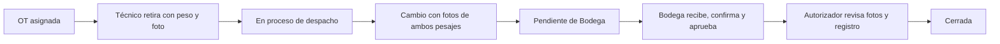

# Base de datos del contexto actual de AFRISAN

Actualización: **25 de octubre de 2026**. Flujo: Técnico retira con peso/foto → cambio físico → Bodega recibe y aprueba → Autorizador revisa y cierra.

## Archivo vigente

Usar únicamente **[04_Crear_Afrisan_Contexto_Actual.sql](04_Crear_Afrisan_Contexto_Actual.sql)**, completo, en SQL Editor de Supabase con la identidad administradora de la base.

- Crea `afrisan_actual` y `afrisan_bi_actual`, con **31 tablas y nueve vistas**.
- Es una instalación vacía: sin roles, usuarios, contraseñas, catálogos ni ejemplos.
- No borra ni migra `afrisan`, `afrisan_nuevo`, `public`, `auth` ni Storage.
- El paquete comparte una transacción. Si esos esquemas nuevos ya existen, falla sin reemplazarlos. No añadir DROP para ocultar ese error: primero revisar lo existente.
- No ejecutar además los archivos 01, 02 o 03: son propuestas anteriores del modelo de cargas a equipos, conservadas como antecedentes.
- Seleccionar `afrisan_actual` en Table Editor/Schema Visualizer. Si una sesión queda en transacción fallida, ejecutar ROLLBACK antes de reintentar.

**No se ejecutó este SQL en tu Supabase. La API actual continúa en memoria.** Instalar tablas no conecta automáticamente EF Core ni migra registros anteriores.

## Correspondencia con el contexto

| Necesidad | Representación nueva |
| --- | --- |
| Cinco roles, incluido Autorizador | Rol y Usuario; sin tabla Permisos. |
| Técnico obligatorio desde la OT | OrdenTrabajo.Id_Tecnico; técnico activo y rol comprobados. |
| Pedido por gas | DetalleOT: solicitado y autorizado por refrigerante. |
| Retiros previstos de sucursal | RetiroPrevisto, independiente del despacho desde Bodega. |
| Técnico retira con peso/foto | Despacho, Pesaje y EvidenciaPesaje; custodia y ubicación actualizadas. |
| Reemplazo o agregado físico | OperacionTerreno vincula instalado/retirado; agregado sin retirado ficticio. |
| Pesos independientes | Pesaje de Inicial, Despacho, Retirado, Instalado y Recepcion. |
| Recepción del retirado | RecepcionBodega referencia la operación; no exige que ese envase haya salido en esa OT. |
| Devolución sin uso | Referencia el despacho exacto. |
| Aprobaciones sucesivas | RevisionOT distingue Bodega y Autorizador; valida orden, actor, fecha y pendientes. |
| Incidencias/rectificación | Solicitud, motivo y respuesta; no reemplaza libremente hechos confirmados. |
| Trazabilidad | CustodiaActual, HistorialCilindro, EventoOT y Auditoria. |
| Límites y jerarquía | LimiteSucursal, historial, bloqueo por Jefatura y desbloqueo explícito. |
| Excesos | MedicionLimite, operaciones relacionadas y RevisionExceso de Jefatura. |
| Costos | Concepto, cantidad, unidad, tarifa y moneda explícitos por operación. |
| Emisiones | Estimación separada con masa emitida, factor, fuente y metodología. |
| Disposición | Baja administrativa, lote pendiente y recepción posterior del certificado. |

El modelo representa reemplazo físico de cilindros: no obliga a inventar un equipo, causa de falla o consumo para guardar el cambio. Las estructuras antiguas de carga de gas a equipos y su semáforo requieren reconciliación si se retoman; no se presentan como el mismo negocio.

## Flujo e integridad

Se conservan peso de salida, terreno y recepción por separado. Las diferencias quedan visibles en `afrisan_bi_actual."PesajesRecepcion"`; no se inventa una tolerancia ni se declaran pérdidas automáticamente. El cierre comprueba registros históricos de esa OT, aunque un envase se reutilice después. Una ejecución parcial exige explicación y libera reservas no ejecutadas al cerrar.

La función `afrisan_actual.retirar_cilindro` registra salida, foto y custodia en una transacción y compara el contenido de los reintentos. La API debe conservar los UUID y usar control de versión al editar borradores; una clave UNIQUE no implementa por sí sola toda la sincronización offline.

## Límites pendientes de definición

Se representan Semana/Mes por sucursal, vigencia, autor e historial. Una modificación de Jefatura bloquea a Bodega; solamente Jefatura puede habilitarla nuevamente. Autorizador no modifica ni desbloquea esos límites porque su permiso de edición sigue por definir.

**No se activa un cómputo automático ni se bloquea el trabajo por exceso.** Deben acordarse masa computable, calendario, fecha aplicable y desglose por gas. MedicionLimite conserva una medición declarada, metodología y versión histórica seleccionada; no sustituye esa definición.

Tarifas, costos, emisiones, baja y certificados se restringen provisionalmente a Administrador técnico. Esa asignación no constituye aprobación del reparto de esas tareas entre roles de negocio; debe ratificarse antes de habilitar sus pantallas. La corrección material de registros aprobados requiere un procedimiento adicional; Incidencia conserva la solicitud y su conclusión sin alterar el original.

## Unidades, archivos y acceso

- Gramos enteros: 1 kg = 1.000 g. Capacidad es masa máxima del gas; tara es masa del envase; contenido según pesaje = bruto menos tara.
- Fechas de hechos en timestamptz. OT con Id_Publico UUID para mapear URLs/API; las PK internas usan identidad. Operaciones con UUID estable y versión de borrador.
- Precios NUMERIC y moneda explícita. No equiparar masa instalada con consumo, cobro ni emisiones. Sin estimación, las emisiones son desconocidas; no cero automático.
- Fotos: metadatos de objetos privados con ruta, MIME, tamaño y SHA-256. La API debe verificar archivo real, firma/hash y acceso Storage antes de confirmar; una ruta o un hash aportado por cliente no prueba una fotografía.
- No hay cuentas precargadas. El backend debe aprovisionar roles/usuarios y hashes seguros. La longitud de Clave_Usuario no comprueba el algoritmo de hash.
- RLS habilitado en todas las tablas; acceso revocado a PUBLIC y, si existen, anon/authenticated. No se publica Data API ni se crean políticas de navegador.
- La API de confianza establece el actor de sesión verificado EN LA MISMA TRANSACCIÓN: `select set_config('afrisan_actual.id_usuario', :id::text, true)`. Nunca aceptar ese valor desde un campo libre del cliente.
- Antes de conectar falta aprovisionar una identidad PostgreSQL de servidor con permisos/políticas adecuados. No poner credenciales PostgreSQL ni claves de servicio en Blazor/JavaScript. El propietario de instalación puede eludir RLS: la prueba como propietario no acredita permisos de backend.
- Power BI requiere una identidad de lectura dedicada y permisos explícitos solo sobre vistas de afrisan_bi_actual. No se exponen contraseñas ni rutas de fotos; el SQL no configura informes, licencias ni acceso de usuarios.

## Validación e integración

Paquete ejecutado en **PostgreSQL 18.6 embebido, PGlite 0.5.11**, con **144 comprobaciones correctas**: tablas vacías, esquema anterior conservado, tres reemplazos, agregado/ejecución parcial, reutilización, roles, recepción, revisiones, límites, costos, emisiones y certificado.

[Resultados y repetición](../04_SEGUIMIENTO/VALIDACION_SQL_CONTEXTO_2026_10_25/README.md).

No se probó en servidor Supabase, con dos conexiones simultáneas, permisos reales de backend, bucket privado, cámara o sincronización de dispositivos. La API sigue usando stores en memoria: falta mapear IDs/relaciones, implementar repositorios/transacciones, configurar autenticación/Storage y repetir los recorridos después de reiniciarla.

Componentes de mantenimiento en `contexto_actual/`. Para reconstruir el paquete: `python contexto_actual/construir_sql.py`. Para instalar se usa solo el archivo 04 generado, no también los componentes.
