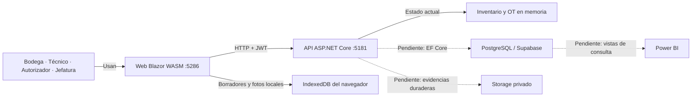

# Investigación de incongruencias y próximos avances de AFRISAN

**20 de octubre de 2026 · Capstone individual de Dante Moya**

La investigación encuentra un prototipo con trabajo sustancial de inventario y
operación técnica, pero todavía no una solución integrada con persistencia,
control de límites y Power BI. El principal problema es la separación entre
cuatro versiones: documentos originales, acuerdos recientes de negocio, SQL
existente y aplicación nueva. El siguiente avance debe hacerlas concordar.

Con defensa el jueves 22 y tres horas diarias, la prioridad inmediata es presentar
un recorrido comprobado y evidencia coherente. La integración completa en nube,
el rediseño de reglas y la reportería no tienen una estimación defendible de seis
horas. Los hallazgos no significan que haya que empezar otra aplicación desde cero.

## 1. Qué está construido y qué falta demostrar

| Área | Evidencia encontrada | Estado que se puede declarar |
| --- | --- | --- |
| Tecnología | Solución nueva con contratos, API y Blazor WASM, todos net8.0. | Base técnica implementada; misma familia tecnológica acordada. |
| Inventario | Catálogo, cilindros, tara/capacidad, pesaje inicial, consulta, ficha y generación QR. | Funciones implementadas en memoria; aceptación funcional pendiente. |
| OT y técnico | Asignación, entrega, reemplazo/agregado, fotos múltiples, incidencias, recepción y cierre. | Recorrido programado con decisiones provisionales y defectos identificados. |
| Autorizador | Creación/asignación, conclusión de incidencias y cierre. | Parcial; una conclusión no ejecuta una corrección de peso. |
| Acceso | JWT y restricciones en API; cinco cuentas públicas de demostración. | Autorización de prototipo; no gestión de usuarios reales. |
| Offline | IndexedDB y reintentos; archivos para publicación como PWA. | Implementación parcial sin evidencia de validación integral; existen problemas de caché/concurrencia. |
| PostgreSQL/Supabase | Scripts y diseño; stores en memoria en la nueva API. | Base diseñada para otro flujo, todavía no integrada con esta app. |
| Límites | Reglas semanales/mensuales y bloqueo por Jefatura documentados. | Sin implementación; fórmula y calendario aún abiertos. |
| Power BI | Requisito reafirmado y vistas SQL del modelo anterior. | Sin informe o integración localizados en el árbol revisado. |
| Costos/emisiones | Criterios del acta y campos SQL anteriores. | Sin cálculo operativo en la aplicación nueva. |
| Evaluación | Informe/plan EVA2 con corte 16/10; nueva entrega técnica 20/10. | Necesita actualización o adenda para defender la misma solución. |

Las observaciones de código se sustentan en [CODIGO.md](CODIGO.md). La compilación
exitosa mencionada en entregas anteriores es evidencia histórica; esta revisión
no la repitió ni ejecutó una prueba completa. Tampoco certifica el estado de la
base en Supabase. No se puede concluir «50% terminado» por número de pantallas.

## 2. Incongruencias que más afectan el proyecto

### A. La base anterior y el negocio nuevo representan hechos diferentes

Dante confirmó reemplazo físico: un envase queda instalado y otro vuelve a
Bodega. El SQL 03 exige intervenciones sobre equipos y vincula el retorno al
mismo cilindro despachado. También condiciona el cierre a estados de retorno
del modelo anterior. Las relaciones aparecen en SQL:146–148,165–172,460–464;
el acuerdo nuevo está en `01_NEGOCIO/07_OT_DEFINICION_DANTE.md`.

**Consecuencia:** no basta agregar una cadena de conexión. Persistir el código
nuevo sobre ese esquema exigiría inventar equipos/consumos o impediría trabajos
legítimos. Hace falta revisar relaciones, estados y reglas del SQL junto con
los criterios de aceptación originales. La aprobación de la arquitectura no
certifica automáticamente el último MER.

### B. El esquema tampoco contempla todas las reglas nuevas

El CHECK de Rol excluye Autorizador; faltan técnico obligatorio en la cabecera
de OT, detalle solicitado/autorizado, pareja retirado/instalado, múltiples
evidencias por pesaje y límites con historial de protección. El prototipo usa
sucursal como texto y usuarios por correo; los informes necesitan identidades
estables. Ver [datos y negocio, D-02 a D-08](DATOS_Y_NEGOCIO.md).

La recomendación antigua de ejecutar el script 02 cuando existe el esquema
también debe corregirse: ese script inserta roles y crea otro esquema, mientras
que Dante pidió cero poblamiento. No se ejecutó ningún script en esta revisión.

### C. Hay defectos funcionales concretos que una compilación no detecta

| Hallazgo estático | Escenario y efecto | Prioridad de preparación |
| --- | --- | --- |
| C03: no existe descarte de borrador de operación | Un segundo borrador vacío sincronizado impide terminar la OT, aunque el reemplazo válido ya esté confirmado. | Primero: puede bloquear una demostración sencilla. |
| C02: custodia/cierre dependen de ubicación global | Un envase devuelto en OT A y vuelto a entregar en B puede alterar la recepción/cierre de A. | Antes de operar varias OT con los mismos cilindros. |
| C01: borrado de foto adelanta versión local | Dos pestañas pueden acabar sobrescribiendo pesos sin el conflicto esperado. | Antes de declarar validada concurrencia/offline. |
| C04: devolución y nueva entrega a la misma OT | La API responde éxito por una entrega histórica, aunque el envase siga en Bodega. | Antes de soportar viajes o entregas repetidas. |
| C05: API permite entregar en PendienteRevision | La pantalla lo restringe, pero una llamada directa puede crear una entrega que el técnico ya no puede ejecutar. | Alinear validación de estado en servidor. |
| C06/C07: caché y fechas offline | Reaparecen copias antiguas; la fecha de sincronización sustituye a la fecha física desconocida. | Antes de calcular acumulados semanales/mensuales. |

Estos escenarios se deducen de las condiciones del código y están documentados
con líneas exactas en [CODIGO.md](CODIGO.md). Deben reproducirse y comprobarse
al corregirlos; no se presentan como pruebas ya ejecutadas. Preparar una demo
acotada no elimina la obligación de registrar esos defectos.

### D. Los kilos autorizados se almacenan, pero aún no controlan el exceso

Hoy se puede registrar una cantidad autorizada y entregar/instalar más sin
generar un exceso automáticamente. Esto es una función pendiente declarada.
Antes de implementarla deben resolverse: kilos que cuentan, separación por gas,
calendario, fecha del hecho, vigencia del límite y permisos del Autorizador.

Se conserva la regla confirmada: registrar el exceso y sus antecedentes para
Jefatura. No se introduce automáticamente un bloqueo ni se equipara exceso
con pérdida o culpabilidad. El límite aplicado debe conservarse históricamente.

### E. Persistencia y evidencia central siguen siendo temporales

Un reinicio de la API pierde registros y fotografías del servidor. IndexedDB
conserva trabajo local, pero no restaura toda la información central. Además,
crear una OT puede declarar como instalado un cilindro que figuraba en Bodega:
es un atajo documentado para preparar el ejemplo, no una operación real de
inventario inicial.

Para la defensa debe explicarse qué queda en RAM, qué en el navegador y qué no
está conectado. Para el siguiente incremento se necesita una trayectoria
persistente completa, con fotos privadas y registro estructurado de cada
recepción/pesaje, antes de construir históricos.

### F. El informe de avance aún describe principalmente la app anterior

EVA2 conserva un corte del 16/10 que habla de `Afrisan.Api/Afrisan.Web` y deja
terreno/fotos/offline pendientes. El código nuevo está en otra solución y ya
incluye parte de esos procesos. Debe agregarse un corte actualizado con estado
por evidencia, manteniendo el antecedente histórico.

También hay planificaciones de dos integrantes que no sirven como reparto
actual del trabajo. Se debe actualizar la responsabilidad futura a Dante y
conservar las autorías anteriores. No hace falta reescribir retrospectivas
para aparentar que siempre fue un trabajo individual.

### G. Git es un pendiente académico concreto

En el corte local, `AFRISAN_NUEVO/` y `EVIDENCIAS_GRUPALES/EVA_2/` aparecen sin
seguimiento; el último commit consultado es `c2a7bfd`, del 08/10. La pauta asigna
20% de su rúbrica a estructura/evidencias en Git. Esto no permite concluir nada
sobre copias externas o el remoto, que no se consultaron.

Dante pidió **no crear commits aún y conservar todo local en una carpeta aparte**.
Se respeta: el paso posterior será seleccionar y registrar el corte cuando lo
solicite. Preparar archivos locales no equivale a entregarlos en Git.

## 3. Lo que cambia por ser un capstone individual

La pauta 2.5 establece grupos de 2–3 e incluye criterios de aportes individuales
y colaboración que suman 25% de la rúbrica. No se encontró constancia docente
de su adaptación individual en las fuentes inspeccionadas. Esto requiere una
confirmación académica, no volver a incorporar nombres que ya no trabajan.

Los otros criterios importantes incluyen evidencia de documentación/programación/
almacenamiento (25%), ajustes justificados (10%) y metodología (10%). Véanse
páginas y requisitos de formato en [CAPSTONE.md](CAPSTONE.md). La entrega vale
20% de la nota según la pauta: ese porcentaje es distinto del 20% interno de Git.

Para una persona, es razonable conservar una única Web, una API y una base,
trabajar un flujo a la vez y reservar tiempo para documentar y demostrar. El
acta admite PWA/IndexedDB, mientras algunos criterios conservan MAUI/SQLite:
registrar la decisión técnica evita desarrollar dos clientes sin necesidad.

El manual de usuario y la matriz formal de trazabilidad siguen aplazados por
decisión de Dante. La próxima entrega puede reutilizar el informe y backlog
existentes, con una adenda breve, en lugar de crear muchos documentos nuevos.

## 4. Power BI: necesario, pero necesita datos bien definidos

El acta incluye Power BI y al menos cinco KPI; el backlog lo recoge y Dante lo
reafirmó. Las vistas SQL existentes aún consultan el modelo de recargas. No se
localizó `.pbix`, `.pbip` ni `.pbit` en el árbol revisado; esto no descarta que
existan fuera del proyecto.

Propuesta incremental: empezar por inventario, OT y cantidades solicitadas/
autorizadas/instaladas; definir después costos, límites y emisiones con sus
fuentes. Conservar explícitamente los cinco KPI comprometidos y registrar la
revisión de los que cambian de significado. No dar por sustituidos los KPI
originales por otra lista sin acuerdo.

No sumar entregas, instalaciones y recepciones como si fueran consumo adicional.
No multiplicar kilos al unir una operación con sus muchas fotos. No convertir
automáticamente gas instalado en emisiones reales ni un valor desconocido en
cero. La discrepancia necesita una definición del indicador antes de una API
externa de emisiones.

La incrustación segura requiere permisos/licencias de Power BI y HTTPS; el
login propio de AFRISAN no basta. El conector PostgreSQL permite plantear vistas
de consulta sin exponer usuarios por la Data API. Las decisiones de conexión,
publicación y factores están respaldadas en [fuentes oficiales](FUENTES_EXTERNAS.md).

## 5. Arquitectura observada y siguiente incremento

Las líneas punteadas indican integraciones pendientes. La app anterior usa
5226/5141. La URL 5226 visible al retomar esta conversación corresponde a esa
app anterior; para defender la nueva hay que abrir la solución de
`AFRISAN_NUEVO/03_CODIGO` y su Web 5286. No se movieron ni borraron proyectos.

Dentro de la API nueva, `InventarioEndpoints/TrabajoEndpoints` reciben las
solicitudes; `InventarioStore/TrabajoStore` validan y mantienen estado;
`SesionesDemo` proporciona acceso de revisión. Esa separación es aprovechable,
pero las colecciones singleton no son repositorios PostgreSQL.

Microsoft fija el fin de soporte de .NET 8 el 10/11/2026, a 21 días de este
corte. Mantener la tecnología acordada para el jueves y planificar la decisión
posterior evita mezclar una migración con la estabilización de la defensa.
Fuente: [política oficial](https://dotnet.microsoft.com/en-us/platform/support/policy).

## 6. Decisiones que desbloquean trabajo después de la defensa

1. Confirmar con cliente el cambio formal de recarga/equipo a reemplazo físico,
   identificando qué requisitos anteriores siguen vigentes.
2. Precisar kilos, período y fecha para límites; definir permiso del Autorizador.
3. Acordar cierre parcial, descarte de borradores, reapertura y corrección de
   registros confirmados, manteniendo historia.
4. Definir inventario inicial en sucursal y cómo vuelve a estar disponible un
   envase vacío: recarga, compra u otro proceso, sin asumirlo implementado.
5. Fijar acceso, fuente y forma de presentación de Power BI, además de la
   semántica de costos y emisiones.

El orden recomendado de ejecución y la preparación inmediata están en
[PLAN_DEFENSA_Y_AVANCES.md](PLAN_DEFENSA_Y_AVANCES.md). El propósito del próximo
incremento es demostrar que un mismo trabajo conserva identidades, fotos,
pesajes, autorizaciones y resultados desde el registro hasta el informe.
