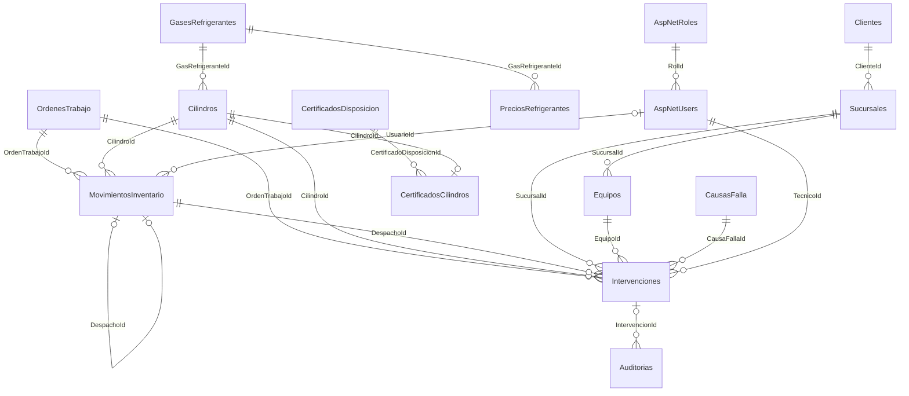

# Modelo de datos implementado

Actualizado el 19 de octubre de 2026. Responsable actual: Dante Moya.

El modelo EF Core incorpora el diseño discutido: un rol por usuario, sucursales,
movimientos de salida/retorno y registros separados de intervención en terreno.
No hay tabla de permisos. Los accesos siguen definidos por rol en los controladores.

## Correspondencia con el MER

| Concepto | Tabla física EF | Decisión |
| --- | --- | --- |
| Usuario / Rol | AspNetUsers / AspNetRoles | AspNetUsers.RolId es FK a AspNetRoles.Id. Identity mantiene hashes, bloqueo y normalización. |
| Cliente / Sucursal | Clientes / Sucursales | Sucursales.ClienteId referencia Clientes.Id. Se reemplazó el borrador Local/LocalId por Sucursal/SucursalId. |
| Cilindro / Refrigerante | Cilindros / GasesRefrigerantes | El QR es un código único, no una imagen. Capacidad, tara y pesajes están en kg. |
| Orden de trabajo | OrdenesTrabajo | Una OT admite varios cilindros mediante sus movimientos y varias intervenciones. No tiene un único CilindroId ni CostoId. |
| Pesaje en bodega | MovimientosInventario | Cada despacho y retorno registra su usuario, foto/ruta y peso bruto. El retorno apunta al despacho exacto. |
| Trabajo en terreno | Intervenciones | OT, cilindro, despacho, sucursal, equipo, causa, técnico, autoriza, cantidad utilizada y foto de balanza. |
| Catálogos de terreno | Equipos / CausasFalla | Soportan HU-05 y HU-07. El equipo debe pertenecer a la sucursal indicada. |
| Precios por fecha | PreciosRefrigerantes | Gas, vigencia, moneda y precio/kg. Los importes son decimal, no float. |
| Historial de cambios | Auditorias | Entidad, registro, actor, fecha y valores JSON. La tabla no captura cambios automáticamente todavía. |
| Disposición Regener | CertificadosDisposicion / CertificadosCilindros | Folio, documento y cilindros asociados; estructura para HU-09. |

Los IDs de entidades existentes se conservan como `int` y los de usuario/rol como
`string` para mantener compatibilidad con el código y las migraciones anteriores.
Los nombres físicos no coinciden uno a uno con los nombres/IDs enteros de las
tablas creadas manualmente en las capturas de Supabase.



## Reglas y cálculos

- Las fotos se representan por claves privadas de Storage (`FotoPesajeRuta` y
  `FotoBalanzaRuta`). No se guardan imágenes binarias ni URLs firmadas que caducan.
- La foto de salida/retorno pertenece a un movimiento. La foto del remanente en
  terreno pertenece a la intervención. Para cerrar una intervención se exige
  ruta de foto, peso restante y fecha de cierre en la base.
- Se separan `EstadoIntervencion`, `EstadoSemaforo` y `EstadoSincronizacion`.
  Un caso rojo exige plan de corrección. Los umbrales del semáforo deben evaluarse
  en el servicio de intervenciones; la restricción no calcula por sí sola el color.
- Se guardan precio/kg, moneda, GWP, fuente y metodología aplicados para conservar
  los históricos. `CostoTotal = KgUtilizados * PrecioKgAplicado` es una columna calculada.
- `KgEmitidos` es nullable: no se supone que todo lo cargado se liberó a la atmósfera.
  `EmisionesCo2eToneladas = KgEmitidos * FactorGwpAplicado / 1000` queda null hasta
  disponer de ambos datos. La metodología para estimar KgEmitidos debe acordarse.
- El UUID de operación de una intervención tiene índice único para evitar duplicados
  al sincronizar. Esto prepara la persistencia; no implementa una app offline.
- El QR y `PesoActualKg` mantienen sus nombres para que la Web actual siga funcionando.
  PesoActualKg es el último pesaje bruto registrado y no reemplaza el historial.

## Migración y Supabase

`AlinearMerRolesSucursalesIntervenciones` parte del esquema de las siete migraciones
EF anteriores. Copia las asignaciones de AspNetUserRoles a RolId antes de quitar
la tabla intermedia. Si una cuenta tiene varios roles, detiene la migración para
que se elija uno explícitamente. La reversión restaura la asignación en la tabla
anterior, pero elimina las tablas/datos nuevos como cualquier rollback de esquema.

La migración también enlaza retornos históricos consecutivos con sus despachos y
recupera la custodia abierta del último despacho de cilindros actualmente despachados.
Los actores de registros antiguos quedan null: no se atribuyen a usuarios inventados.
Pesajes con más de tres decimales o fuera del rango admitido detienen la migración
antes de alterar los datos, en lugar de redondearlos silenciosamente.

Hay dos scripts generados desde las migraciones:

- `Scripts/InstalacionCompleta.sql`: para un esquema vacío, incluye el historial EF.
- `Scripts/ActualizarDesdeIdentity.sql`: para la base EF que termina en AgregarIdentityUsuariosRoles.

Las tablas que Dante creó manualmente en Supabase **no equivalen al esquema EF**.
Antes de aplicar esos scripts allí se necesita comparar el DDL real, respaldar y
reconciliar las tablas manuales. No ejecutar ambos conjuntos en paralelo ni marcar
migraciones como aplicadas sin que el esquema coincida. El inicializador detecta
varios nombres de las tablas manuales y se detiene si no hay historial EF.

Ningún script elimina las tablas manuales. No se ha aplicado esta migración a Supabase.

## Configuración y comprobación

Configurar `ConnectionStrings:DefaultConnection`, `Jwt:Issuer`, `Jwt:Audience`,
`Jwt:Key` y, si se desea crear el administrador inicial, `AdminSeed:Email`,
`AdminSeed:Password`, `AdminSeed:NombreCompleto` mediante User Secrets o variables
de entorno. El repositorio no contiene credenciales.

Después de reconciliar el esquema y revisar el SQL, el comando explícito para
aplicar las migraciones y crear los cuatro roles es:

```powershell
dotnet run --project Afrisan.Api -- --Demo:Enabled=false --initialize-database
```

El arranque normal solo verifica migraciones y crea los roles/administrador
configurados; no actualiza automáticamente la estructura. `/health/ready` comprueba
conectividad y migraciones pendientes.

La migración habilita RLS y retira los permisos directos de `anon` y `authenticated`
si esos roles existen. `RestringirDataApi.sql` permite repetir esa protección con
la conexión de administración. El backend necesita un usuario con acceso autorizado
(por ejemplo, el propietario de las tablas). Los usuarios finales acceden mediante
Afrisan.Api; los accesos de reportería/Power BI se configuran por separado.
La reversión conserva RLS en las tablas anteriores por seguridad; no abre la Data API.

## Alcance del cambio

Modelos, relaciones, restricciones, migración, almacenamiento de actor/foto en los
endpoints existentes de movimientos y formulario/API de gases con GWP actualizados.
La lectura/asignación de roles de Identity usa el nuevo FK mediante UsuarioStore.

Todavía se requieren endpoints/pantallas para las entidades nuevas, el servicio de
registro/cierre de intervenciones (validar custodia, saldo y autorización), la carga
real de archivos a Storage, sincronización offline, captura automática de auditoría,
conciliación completa con consumo declarado y cierre de OT, integración Defontana y BI.
La existencia de tablas no demuestra que esas funciones estén implementadas.
